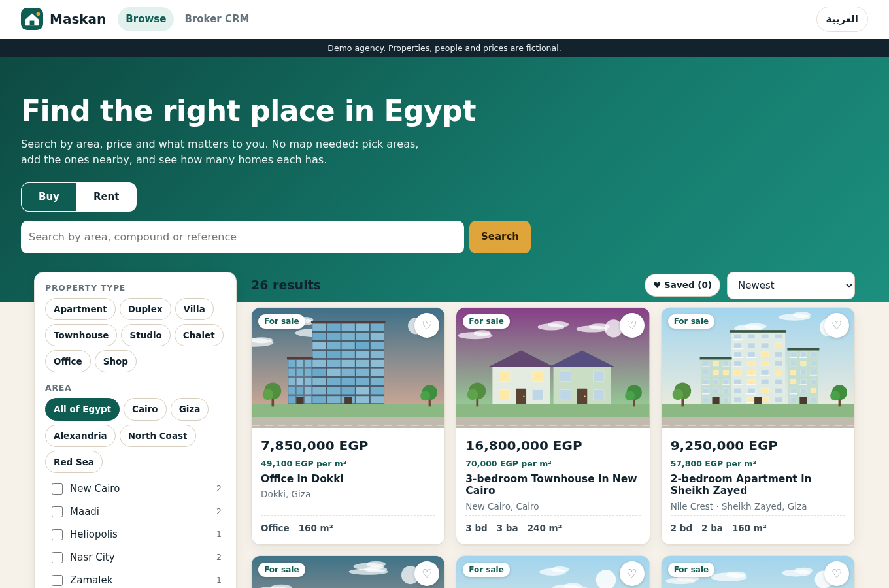
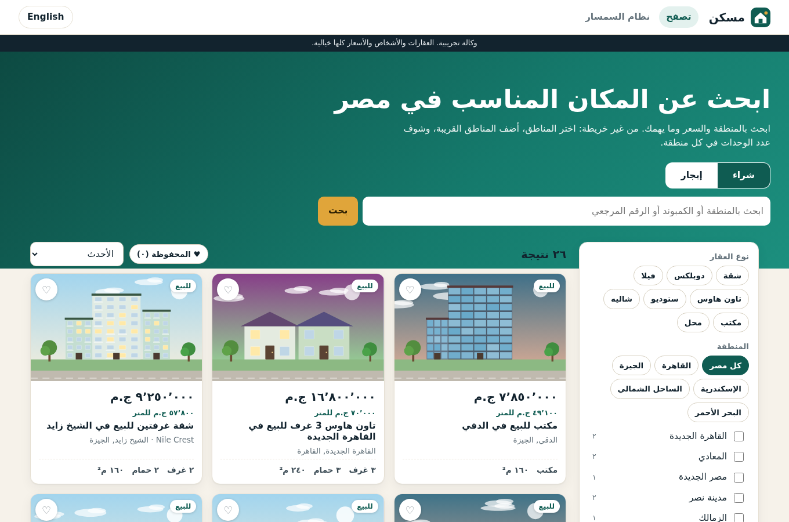
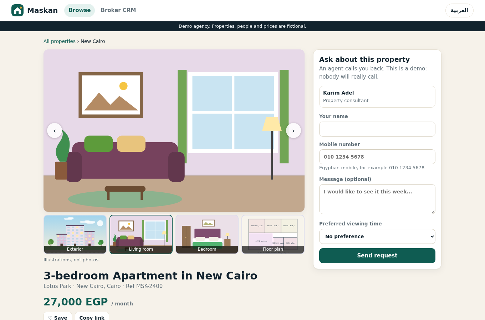
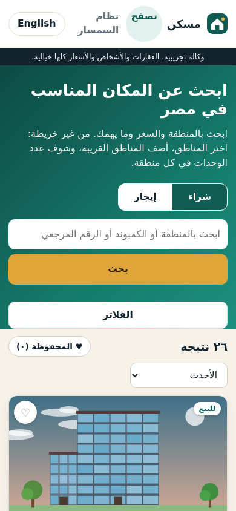
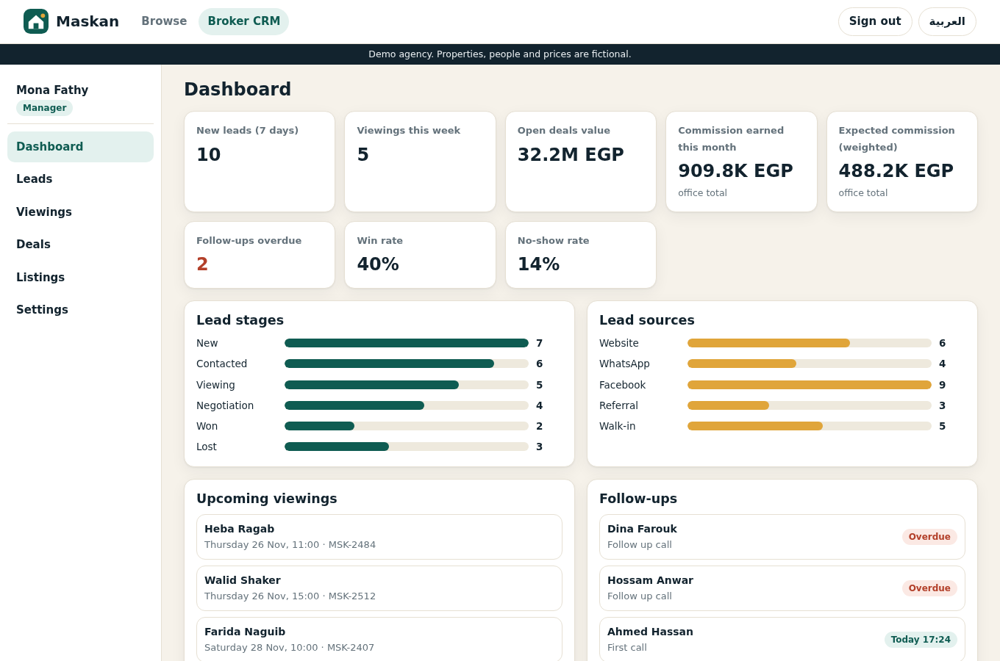
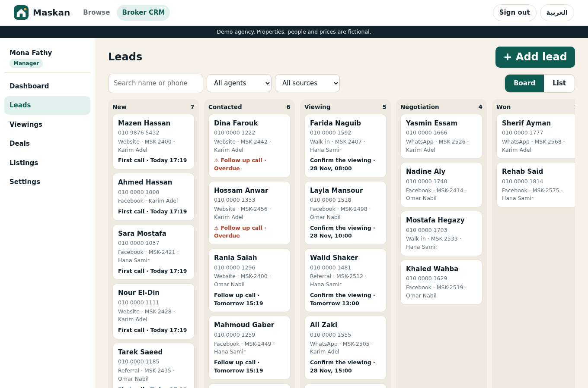
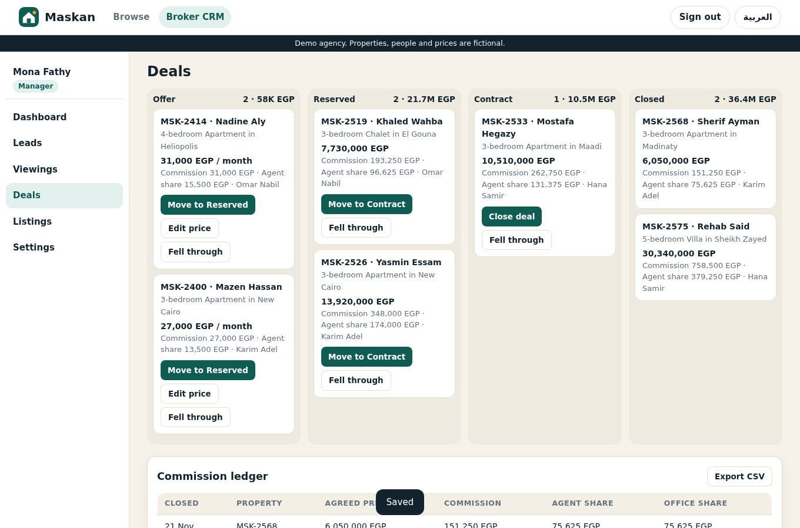
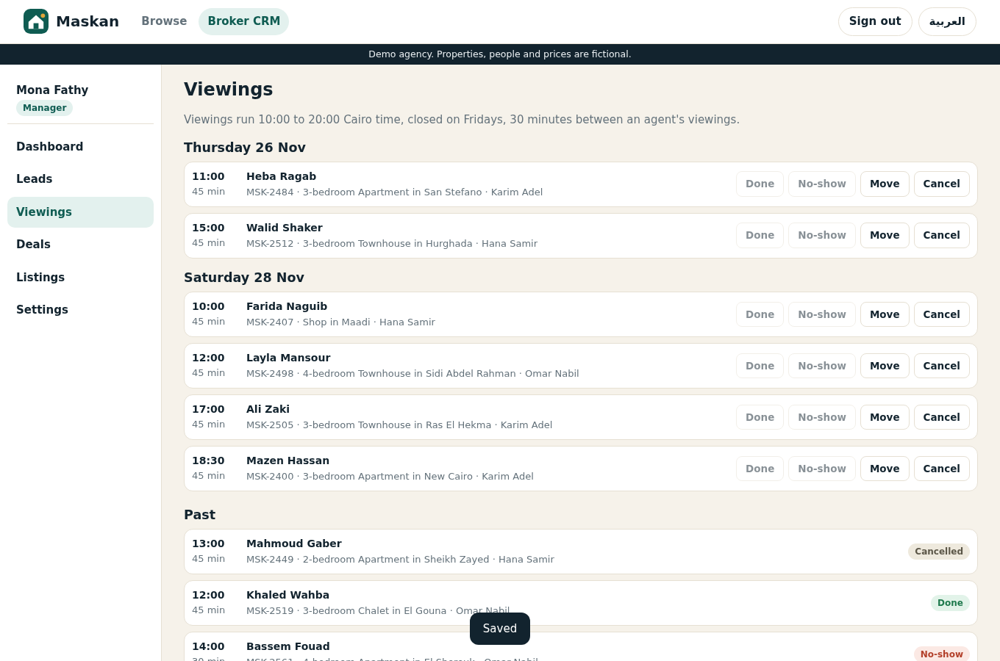

# Maskan (مسكن): real-estate marketplace and broker CRM (portfolio demo)

A bilingual (English and Arabic, right to left) system for an Egyptian real-estate agency in one small codebase. The public site lists properties with search and filters that need no map. Brokers work in a CRM with leads, a viewings schedule, a deals pipeline and commission.

**Live demo:** https://maskan-real-estate-nine.vercel.app  
Browse: `/` · Property: `/property?id=...` · Broker CRM: `/crm`

Demo sign-in (public on purpose, this is a demo): manager **Mona**, PIN `2468`. Agents **Karim**, **Hana**, **Omar**, PIN `1357`.

| Arabic (RTL) browse | Property detail | Mobile Arabic |
|---|---|---|
|  |  |  |

| Leads | Deals pipeline | Viewings |
|---|---|---|
|  |  |  |

## What it does

**Public site (works offline after the first visit)**
- 38 public listings for sale or rent, with search by area, compound or reference number.
- Filters: buy or rent, property type, region, areas, price, bedrooms, size. No map: instead you pick areas and can add nearby areas, and the count per area is shown. Filters live in the URL, so a search can be shared.
- Property detail: illustrated gallery, facts, installment estimate, similar properties, saved favourites, inquiry form.
- Inquiry form: an offline inquiry is queued on the phone and sent when the connection returns, exactly once.

**Broker CRM (roles: manager and agent)**
- Dashboard: new leads, viewings today, pipeline value, commission this month.
- Leads: stages, source, budget, notes timeline, suggested matching listings. Agents see only their own leads and deals; the manager sees all and can reassign.
- Viewings schedule by day, with done, no-show, move and cancel.
- Deals pipeline: Offer, Reserved, Contract, Closed. Commission ledger with CSV export.
- Listings management: publish or hide, price edits, status.

## Rules the server enforces
- Prices and commission are computed on the server. Defaults: sale 2.5% of price, rent one month of rent, agent share 50%.
- Only the manager can close a deal. Agents cannot touch other agents' leads (403). Calls without a session get 401.
- Viewings run 10:00 to 20:00 Cairo time, closed on Fridays, with 30 minutes between one agent's viewings. Double booking is refused.
- Public inquiries: 3 per hour per phone number, a hidden honeypot field, an idempotency key, and a repeat inquiry from the same phone merges into the open lead.
- Every rendered value is escaped.

## How it is built
- Plain HTML, CSS and ES modules. No framework and no build step.
- One serverless function (`api/data.js`) applies validated operations from `api/_logic.js` (pure logic, no I/O). Search and matching in `public/shared.js` are shared by browser and server.
- Storage: Vercel Blob, as versioned JSON files.
- `public/sw.js`: service worker that caches the shell and the data for offline browsing.
- `dev-server.mjs`: same API in memory for local work (`npm run dev`).
- Illustrations are generated SVG (`public/art.js`).

## Tests
- `npm test`: 34 business-rule tests (search and filters, nearby areas, commission, viewing rules, roles, inquiry limits and merging, idempotency, validation).
- `node e2e/e2e.mjs <url> [screenshot-dir]`: browser run with puppeteer-core and Chrome, about 32 checks: search and filters, URL filters, Arabic RTL, inquiry, hostile HTML shown as text, manager and agent permissions, viewing rules, offline inquiry queue, no page errors. Passed locally and against the live demo.

## Honest limits (this is a demo, not a product ready for a real agency)
- Built by an AI assistant (Instinct) under Nada Gamal's direction. Listings, people and prices are fictional and illustrative.
- Illustrations, not photos. No map by design.
- One shared demo workspace, last writer wins, resets every 6 hours.
- The PINs are public. This is not real authentication: a real system needs accounts, hashed credentials and audit logs.
- The CRM is read-only offline. Only public browsing and inquiries work offline.
- No payments, no listing portal integration, no WhatsApp or SMS sending, no document storage, no multi-agency tenancy.
- Times use a fixed Cairo offset (UTC+2). Commission rules are demo defaults, not legal advice.

MIT license.
